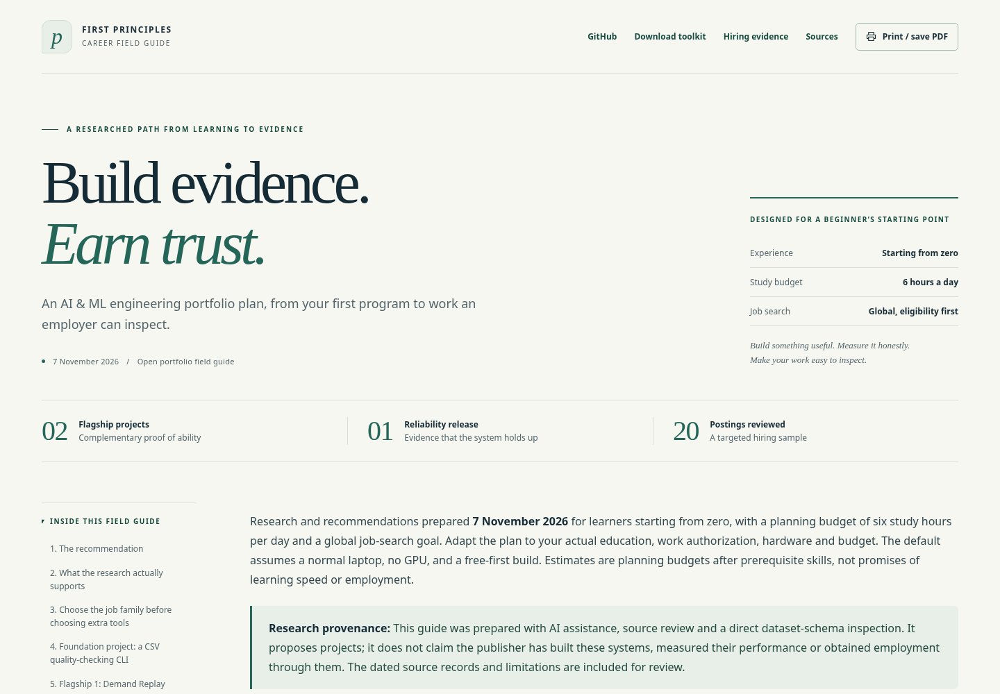

# AI & ML Engineering Portfolio

**Build useful systems. Evaluate them honestly. Make your work easy to inspect.**

A research-informed guide to choosing, building, and showcasing an AI/ML engineering portfolio—from a first Python program to two substantial projects, a reliability release, and a useful open-source contribution.

[Read the guide](https://mjmuhammadjihad.github.io/AI-ML-Engineering-Portfolio/) · [Download the toolkit](downloads/AI-ML-Hiring-Portfolio-Toolkit.zip) · [PDF](downloads/AI-ML-Hiring-Portfolio-Plan.pdf) · [Portable HTML](downloads/AI-ML-Hiring-Portfolio-Plan.html) · [Markdown](downloads/AI-ML-Hiring-Portfolio-Plan.md)



## What to build

| Step | Project | Evidence it develops |
| --- | --- | --- |
| Foundation | CSV quality checker | Python, data validation, tests, Git, and independent debugging |
| Flagship 1 | **Demand Replay** | Prediction-time data boundaries, forecasting baselines, temporal evaluation, and a small API |
| Flagship 2 | **Evidence Desk** | Retrieval, citations, abstention, grounded-answer evaluation, and measured cost/latency |
| Reliability | A release inside one flagship | Timeouts, fallbacks, monitoring, regression checks, and a controlled rollback drill |
| Collaboration | A focused contribution to a tool you use | Reproduction, a useful correction, review response, and accurate contribution credit |

The guide specifies scope, prerequisites, evaluation protocols, failure cases, publishable evidence, and interview questions. The toolkit includes a project README, evaluation plan, experiment log, case study, post drafts, and CSV trackers for milestones, results, and applications.

## Who this is for

The default path assumes a complete beginner, a normal laptop, and roughly six focused study hours on six days each week. A 24-week first pass provides structure; progress depends on demonstrated understanding, and may take longer. Paid APIs and a GPU are optional. Eligibility, work authorization, location, and role requirements still determine which opportunities are relevant.

The HTML is self-contained and works without JavaScript or external assets. Internet access is needed only to follow external source links. Open the downloaded HTML directly in a browser, or use the PDF for reading and printing.

## What the research establishes

Prepared **7 November 2026**, the guide draws on **20 postings from 11 employers** and **25 source documents**, with dates, short attributed excerpts, qualification boundaries, and provenance records.

This is an AI-assisted research and editorial project. The hiring sample is purposive and weighted toward large technology companies; it is not a global labor-market census or a list of guaranteed current vacancies. Project choices, schedules, budgets, and readiness gates are recommendations rather than a validated hiring formula.

The official Bike Sharing archive was inspected for schema and feasibility. **The proposed ML/AI projects were not built or evaluated as part of this research, and no model-performance results are claimed.** Templates are unfilled working documents. A portfolio can demonstrate skills; it cannot guarantee employment or replace explicit eligibility requirements.

## Start here

1. Read the recommendation, foundation project, and next-seven-days sections of the guide.
2. Build a small CSV checker you can run, test, repair, and explain independently.
3. Copy the relevant [templates](templates/) into your own project. Replace placeholders with verified information or `not measured`.
4. Choose the first flagship according to the work in roles you could actually accept.

For the broader learning sequence, see the separate [AI-ML-Engineering-Roadmap](https://github.com/MJmuhammadjihad/AI-ML-Engineering-Roadmap). This repository focuses on portfolio decisions and evidence.

## Repository layout

```text
content/       Authored strategy and HTML template
evidence/      Reviewed jobs, source ledger, dataset inspection
templates/     Editable project and publishing worksheets
downloads/     Portable HTML, Markdown, PDF, and toolkit ZIP
index.html     Browsable guide
build.py       Rebuild generated artifacts
tests/         Release consistency checks
```

Raw full employer feeds, complete source-page captures, and the dataset itself are not redistributed. Capture identifiers and hashes record research provenance; they do not imply those raw files are included.

## Build and check

With Python and an isolated virtual environment:

```bash
python -m pip install -r requirements-build.txt
python build.py
python tests/check_release.py
```

The PDF is a maintained generated artifact. Refresh and inspect it when guide content changes; the standard build must not be assumed to regenerate it automatically. Check links, mobile layout, print output, and download consistency before releasing a revision.

To refresh the PDF, previews and browser-check records after rebuilding the HTML:

```bash
python -m pip install -r requirements-browser.txt
python -m playwright install chromium
python tests/check_browser.py
python build.py
python tests/check_release.py
```

The release check verifies that the PDF was generated from the current HTML and that the toolkit matches its checksum manifest. The optional browser check uses a local HTTP server and makes no external requests from the guide.

## Contribute

Corrections, clearer explanations, better evaluation protocols, accessibility fixes, and well-sourced updates are welcome. Read [CONTRIBUTING.md](CONTRIBUTING.md), preserve the difference between requirements and preferences, and attach evidence to factual changes. Keep personal application notes and credentials out of public contributions.

Maintained by [Md. Jihad](https://github.com/MJmuhammadjihad). Use repository issues for reproducible problems and focused suggestions.

## License

Original code, analysis, documentation, and templates are available under the [MIT License](LICENSE). Third-party quotations and referenced materials retain their own rights; see [THIRD_PARTY_NOTICES.md](THIRD_PARTY_NOTICES.md). No endorsement by a cited employer, platform, or source is implied.
