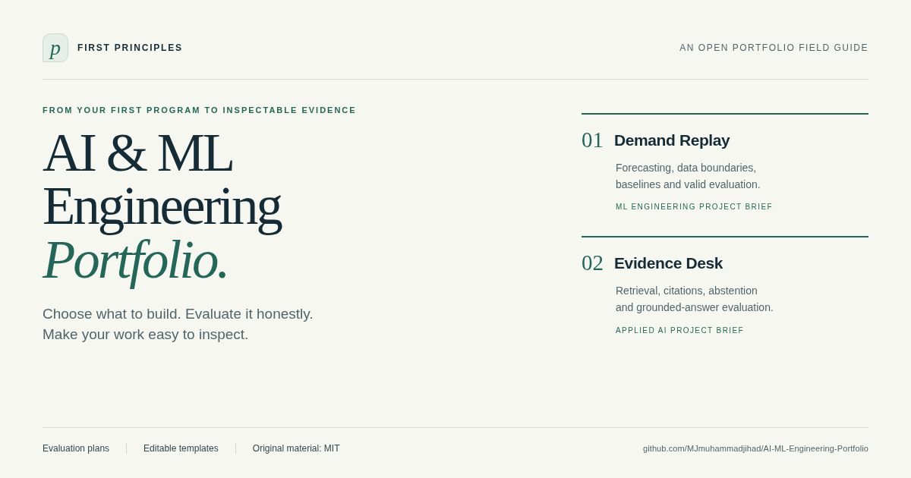

# AI & ML Engineering Portfolio

**Choose what to build. Know how to evaluate it. Show evidence of your work.**

An open guide for turning AI/ML study into a portfolio a hiring team can inspect: two flagship project briefs, evaluation protocols, a reliability release, and reusable GitHub/LinkedIn templates.

[](LICENSE)
[](https://github.com/MJmuhammadjihad/AI-ML-Engineering-Portfolio/actions/workflows/check.yml)
[](https://github.com/MJmuhammadjihad/AI-ML-Engineering-Portfolio/releases/latest)

**[Open the interactive guide →](https://mjmuhammadjihad.github.io/AI-ML-Engineering-Portfolio/)** · **[Download the complete toolkit](https://github.com/MJmuhammadjihad/AI-ML-Engineering-Portfolio/releases/latest/download/AI-ML-Hiring-Portfolio-Toolkit.zip)**

[PDF](https://github.com/MJmuhammadjihad/AI-ML-Engineering-Portfolio/releases/latest/download/AI-ML-Hiring-Portfolio-Plan.pdf) · [Portable HTML](https://github.com/MJmuhammadjihad/AI-ML-Engineering-Portfolio/releases/latest/download/AI-ML-Hiring-Portfolio-Plan.html) · [Editable Markdown](downloads/AI-ML-Hiring-Portfolio-Plan.md) · [Templates](templates/)

[](https://mjmuhammadjihad.github.io/AI-ML-Engineering-Portfolio/)

## Start where you are

| Your next decision | Start here |
| --- | --- |
| “I am starting from zero.” | [Build a small CSV checker](https://mjmuhammadjihad.github.io/AI-ML-Engineering-Portfolio/#4-foundation-project-a-csv-quality-checking-cli), then use the [first seven days](https://mjmuhammadjihad.github.io/AI-ML-Engineering-Portfolio/#15-your-next-seven-days). |
| “I want to build applied AI products.” | Read the [Evidence Desk brief](https://mjmuhammadjihad.github.io/AI-ML-Engineering-Portfolio/#6-flagship-2-evidence-desk): retrieval, citations, abstention and answer evaluation. |
| “I want to demonstrate ML engineering.” | Read the [Demand Replay brief](https://mjmuhammadjihad.github.io/AI-ML-Engineering-Portfolio/#5-flagship-1-demand-replay): data timing, baselines, temporal evaluation and an API. |
| “I have a project. How do I present it?” | Use the [evidence bundle](https://mjmuhammadjihad.github.io/AI-ML-Engineering-Portfolio/#9-package-every-claim-with-its-evidence) and [case-study template](templates/case-study.md). |

The guide’s local planning panel lets you choose a role focus, adapt the study budget, track milestone checks and export a Markdown plan. Progress stays in your browser; checking a box records your own progress, not a skill certification. The full guide remains readable without JavaScript.

## What you get

| Deliverable | What it helps you demonstrate |
| --- | --- |
| **CSV quality checker** | Finish, test, debug and explain a small Python tool. |
| **Demand Replay** | Define what is known at prediction time, compare fair baselines and publish reproducible forecast evidence. |
| **Evidence Desk** | Build a bounded documentation assistant and measure whether its answers are supported. |
| **Reliability release** | Show failures, timeouts, fallbacks, monitoring limits and a controlled rollback. |
| **A useful contribution** | Reproduce a real problem, improve an existing tool and respond to review. |

Each brief includes prerequisites, scope, evaluation rules, failure cases, publishable artifacts and interview questions. Start with a normal laptop; paid APIs and a GPU are optional. The 24-week schedule is a first-pass planning scaffold at six focused hours on six days per week. Extend it when the evidence gates are unmet.

**Copy a worksheet and start:** [project README](templates/project-readme.md) · [evaluation plan](templates/evaluation-plan-and-results.md) · [experiment log](templates/experiment-log.md) · [case study](templates/case-study.md) · [publishing checklist](templates/publishing-checklist-and-posts.md) · [application tracker](templates/role-application-tracker.csv)

The portable HTML has no external runtime assets. Download it once and read it offline; following source links requires internet access. PDF and Markdown versions are included in every release.

## Evidence you can inspect

The research was prepared **7 November 2026** from **20 job postings across 11 employers** and **25 source documents**. Explore the [hiring evidence](https://mjmuhammadjihad.github.io/AI-ML-Engineering-Portfolio/#appendix-jobs), [sources](https://mjmuhammadjihad.github.io/AI-ML-Engineering-Portfolio/#appendix-sources), and [machine-readable records](evidence/).

This is an **AI-assisted research and editorial project**. The hiring sample is purposive and weighted toward large technology employers. It is not a global census or a list of guaranteed current vacancies. Location, work authorization, experience and degree requirements must be checked for each opportunity.

The official Bike Sharing archive was inspected for schema and feasibility. The proposed ML/AI systems were **not built or evaluated as part of this research**; no model-performance or employment outcomes are claimed. Templates are deliberately unfilled. Project choices and time budgets are recommendations, not a validated hiring formula.

## Help make the next edition better

Useful contributions include a source-backed correction, an unclear prerequisite, a broken reproduction step, an accessibility fix, or feedback from actually trying one of the briefs. Read [CONTRIBUTING.md](CONTRIBUTING.md) and [open a focused issue](https://github.com/MJmuhammadjihad/AI-ML-Engineering-Portfolio/issues/new/choose).

If this guide helps you choose or evaluate a project, **star it to find it again**, share the section that helped, or send a specific improvement. A short explanation of what you tried is especially useful.

For maintainers and readers who want to share it: [ready-to-adapt announcement drafts](docs/SHARE-KIT.md) · [a sustainable growth checklist](docs/MAINTAINER-GROWTH.md).

For the broader learning sequence, visit the separate [AI-ML-Engineering-Roadmap](https://github.com/MJmuhammadjihad/AI-ML-Engineering-Roadmap).

<details>
<summary><strong>Build, validate and contribute to the source</strong></summary>

The authored guide lives in `content/`; evidence summaries in `evidence/`; worksheets in `templates/`. `build.py` generates the HTML, Markdown and toolkit. The PDF is a maintained generated artifact.

With Python and an isolated virtual environment:

```bash
python -m pip install -r requirements-build.txt
python build.py
python -m unittest discover -s tests -p 'test_*.py'
python tests/check_release.py
```

After changing guide content or presentation, refresh the PDF, previews and browser-check records:

```bash
python -m pip install -r requirements-browser.txt
python -m playwright install chromium
python tests/check_browser.py
python build.py
python tests/check_release.py
```

The release check verifies that the PDF was generated from the current HTML and that the toolkit matches its checksum manifest. Browser checks use a local HTTP server. Raw full employer feeds, complete source captures and the dataset are not redistributed; capture identifiers and hashes describe research provenance.

</details>

## License and credits

Maintained by [Md. Jihad](https://github.com/MJmuhammadjihad). Original code, analysis, documentation and templates are [MIT-licensed](LICENSE). Third-party quotations and referenced materials retain their own rights; see [THIRD_PARTY_NOTICES.md](THIRD_PARTY_NOTICES.md). Cited employers and platforms do not endorse this guide.
